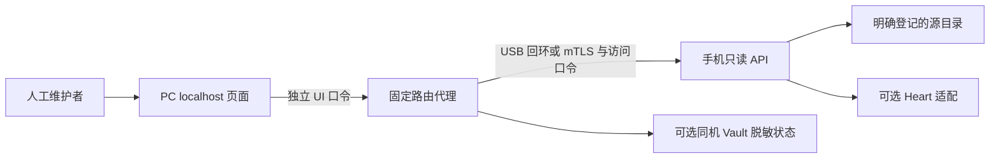

# 架构与演进

## 职责边界

手机查看、备份验证和模型工具具有不同权限与生命周期，分别实现。remote-files 不接管 Vault，不注册模型工具，不通过模型决定人工访问是否允许。

| 模块 | 职责 |
|---|---|
| `lib/files.mjs` | 逻辑根、路径边界、lstat 类型判断、分页、版本与有界文本读取 |
| `lib/server.mjs` / `lib/client.mjs` | 固定路由、认证、连接限制、mTLS 与取消 |
| `lib/config.mjs` / `lib/auth.mjs` | 配置、凭据、私网/回环约束 |
| `lib/pairing.mjs` / `pc/pair-usb.mjs` | 一次性会话、公钥脚本、密文导出与认证后落盘 |
| `lib/plugin.mjs` / `lib/heart.mjs` | Cordis 生命周期、可选服务与元数据观察 |
| `phone/serve.mjs` | 独立运行入口 |
| `pc/browser.mjs` / `pc/server.mjs` | localhost 代理、可选 Vault 状态投影 |
| `pc/open.ps1` | Windows USB 连接与页面启动 |
| `web/` | 文件树、预览、刷新、空状态与离线提示 |

## 协议

固定 GET `/v1/status`、`/v1/roots`、`/v1/list`、`/v1/stat`、`/v1/read`。文件请求只接受登记的逻辑 root 和相对 path。没有路径写入、执行、上传、生产恢复或任意目标代理接口。

`list` 返回条目、revision、nextOffset、scannedEntries 和 omitted 分类计数。扫描计数只代表本次扫描，不是整棵树统计。敏感项不返回名称或正文。

Proot 可能使目录枚举提示与容器 lstat 结果不一致。Dirent 仅提供名称，策略对逐项 lstat 结果执行。读取时仍使用 NOFOLLOW、句柄身份、父目录与前后版本复核；不能以这个适配推断 Android 原生侧安全或修改源文件。

## 一致性和生命周期

一次文本读取返回观察时间和版本，并检查读取期间的源变化。多个文件没有同一瞬间的一致性保证；数据库需独立业务接口或事务一致副本，不能分别下载活跃 db/WAL 当作快照。

PC 只监听 localhost，严格匹配 Host/Origin，页面使用 CSP、textContent 和 no-store。远端访问口令留在 PC 服务进程，页面只持有独立 UI 口令。服务卸载关闭连接和 Heart 订阅，Heart 缺席不影响人工读取。

## 演进节点

1. **有界业务视图**：日志尾读、压缩会话片段；明确格式、限额、取消和观察时间。
2. **SQLite 查看**：只读源连接与 Online Backup 独立副本；只对副本检查、规范化和查询，并验证原生源形态。
3. **历史浏览**：由 PC 适配器选择 Vault 明确已验证的快照 ID；页面区分历史和当前文件，凭据不出 PC。
4. **变更通知**：只订阅已打开范围，通知后按需重新获取，断线重连重新核对版本。
5. **资源协调**：可延期重任务参考 Heart，维护观察只有元数据；不改变灾备独立门禁，不自动开放模型文件权限。
